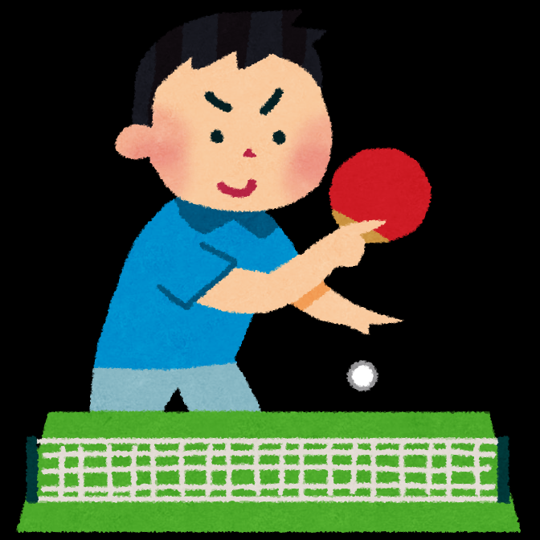
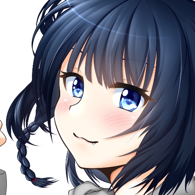
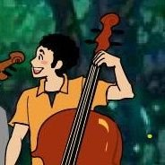
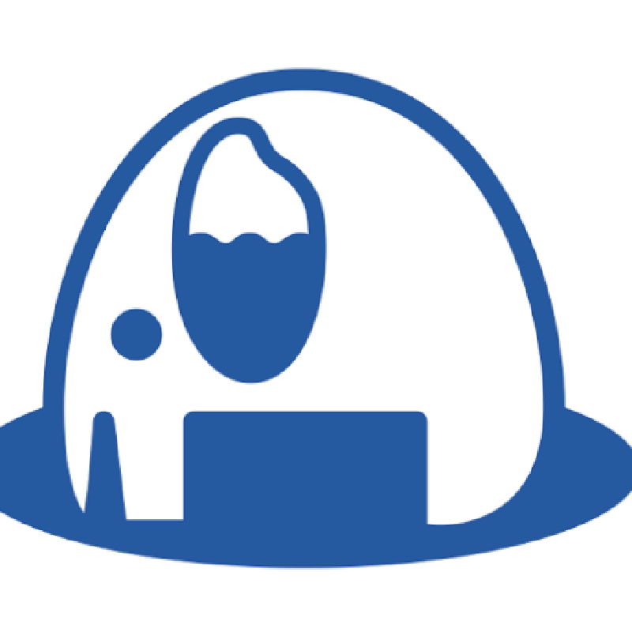
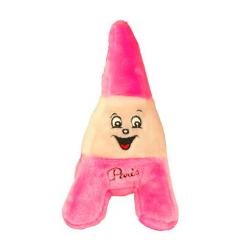
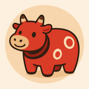
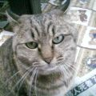
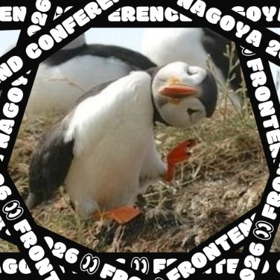
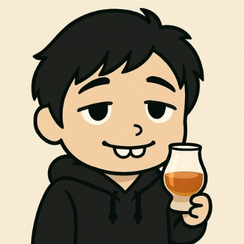

<!-- _class: title -->

# PHPカンファレンス新潟2026のご紹介 - 11/14(土)は新潟に行きませんか？ -

2026/10/21 PHP勉強会@東京

おさない

---

---

# この発表の目的とゴール

* コアスタッフである私が、PHPカンファレンス新潟2026の魅力を紹介する
* みなさんがチケットを買っていること
  * 11/14(土)、みなさんが新潟に来ていること

<!--
ゴールは「知ってもらう」ではなく「来てもらう」。最後のQRスライドで回収する。
-->

---

# アジェンダ

1. PHPカンファレンス新潟2026とは
2. セッションの魅力
3. セッション以外のカンファレンスの魅力

---

<!-- _class: message -->

# 1. PHPカンファレンス新潟2026とはOverview

---

<!-- _class: promo -->

# 開催概要

* **日時**：2026/11/14(土) 10:00〜18:00（09:30 入場開始）
* **会場**：朱鷺メッセ（新潟駅から徒歩約20分 / バス約10分）
* **テーマ**：「新潟でかみしめて、つなぐ、つくる、つぎの未来へ。」

https://phpcon.niigata.jp/

---

# チケット

| 種別 | 内容 | 価格 |
|---|---|---|
| 一般 | 本編 ＋ お弁当 | 3,500円 |
| 一般（懇親会つき） | 本編 ＋ お弁当 ＋ 懇親会 | 8,000円 |
| 個人スポンサー | 本編 ＋ お弁当 ＋ 懇親会 ＋ 公式サイトにアイコン掲載 | 13,000円 |
| 個人スポンサー（本編参加なし） | 公式サイトにアイコン掲載 | 5,000円 |

※現地参加のチケットにはすべて新潟三新軒様のお弁当がつきます。
※私含めてスタッフを通して買うと、500円安くなります

---

<!-- _class: message -->

# 2. セッションの魅力Sessions

---

# どんなセッションを選んだか

* **主なペルソナ**：この人たちに楽しんでほしい
  * カンファレンスの参加歴や、PHP歴が短い方
  * 新潟在住・在勤の方（メイン言語がPHPではない方も）
* **だから**
  * 初心者向けのセッションを **8本** と多めに採用
  * 言語を問わず楽しめるセッションが **17本**

<!--
「全国のPHPer向け」だけでなく「まだ慣れていない人」「新潟の、PHP以外のエンジニア」が楽しめるように選んだ、が軸。
募集時も、PHP以外（DB・インフラ・CS・AI）の話や、新潟ゆかりの方・初登壇・初心者向けのトークを特に歓迎していた。
-->

---

# 当日の登壇者

<figure><figcaption>梶川さん</figcaption></figure>
<figure><figcaption>meiheiさん</figcaption></figure>
<figure><figcaption>村田さん</figcaption></figure>
<figure><figcaption>あすと.さん</figcaption></figure>
<figure><figcaption>tadsanさん</figcaption></figure>
<figure><figcaption>sizuhikoさん</figcaption></figure>
<figure><figcaption>河瀨さん</figcaption></figure>
<figure><figcaption>松尾さん</figcaption></figure>
<figure><figcaption>小泉さん</figcaption></figure>
<figure><figcaption>ざきさん</figcaption></figure>
<figure><figcaption>wakabaさん</figcaption></figure>
<figure><figcaption>赤間さん</figcaption></figure>
<figure><figcaption>ゆずねりさん</figcaption></figure>
<figure><figcaption>つっつんさん</figcaption></figure>
<figure><figcaption>あきさん</figcaption></figure>
<figure><figcaption>ポチさん</figcaption></figure>
<figure><figcaption>永瀬さん</figcaption></figure>
<figure><figcaption>かはぴぴさん</figcaption></figure>
<figure><figcaption>ムナカタさん</figcaption></figure>
<figure><figcaption>マグロさん</figcaption></figure>
<figure><figcaption>福井さん</figcaption></figure>
<figure><figcaption>fkuMnkさん</figcaption></figure>
<figure><figcaption>河村さん</figcaption></figure>
<figure><figcaption>あくしもさん</figcaption></figure>

<!--
アイコンは fortee（公式サイトと同じ画像）。赤間さんはアイコン未登録のため fortee の既定アイコン。
並びはタイムテーブル順。
-->

---

# セッションをテーマ別に見る

| テーマ | 本数 | 初心者向け | 言語を問わず |
|---|---|---|---|
| ① AI時代、エンジニアの仕事はどう変わる？ | 3 | 1 | 2 |
| ② より良いコードと開発現場をつくるには？設計する / 課題を見つけて改善する | 7 | 1 | 5 |
| ③ エンジニアとして、新しい一歩を踏み出してみませんか？自分の力を育てる / 新しい世界へ踏み出す | 6 | **3** | 5 |
| ④ PHPの奥深さを探るもう一段深く知る / 技術の可能性を探る | 6 | 2 | 2 |
| ⑤ コードの外に広がる、エンジニアの世界 | 3 | 1 | 3 |

ラベル：初心者向け初登壇新潟枠（fortee のタグ）言語を問わず PHP以外がメインの人にもおすすめ　Track欄の「LT」は5分のライトニングトーク

<!--
5テーマは公式のセッション紹介（公開予定）の章立て。
PHP歴が短い方は③から、PHP以外がメインの方は「言語を問わず」の多い②③⑤から見てもらう。
-->

---

<!-- _class: sessions -->

# ① AI時代、エンジニアの仕事はどう変わる？

| 時刻 | セッション / キーワード｜見どころ | 登壇者 |
|---|---|---|
| 14:40 A | 生成AIを用いてチーム開発する際の７つのポイント初心者向け言語を問わずチーム開発・仮説検証｜観察・データ・多様なチームの7ポイントを漫画で整理 | 小泉岳人さん |
| 14:40 B | AI駆動で挑む！？レガシーPHPプロダクトのバージョンアップへの軌跡初登壇レガシー・PHP 8.4｜8万テーブルの生PHPを、7.3から8.4へ | ざきさん |
| 15:10 A | AIコーディングをセッションで終わらせない：PHPライブラリ開発におけるコンテキスト承継設計新潟枠言語を問わずコンテキスト承継｜「忘れるAI」でも引き継げる作業日誌と判断基準 | wakabaさん |

<strong>こんな人に聴いてほしい</strong>：古いPHPの改修や、AIのコードレビューに悩む人

---

<!-- _class: sessions -->

# ② より良いコードを設計する

| 時刻 | セッション / キーワード｜見どころ | 登壇者 |
|---|---|---|
| 10:50 A | 疎結合とは何か？結合バランスについて考える初心者向け言語を問わず結合度・設計｜結合を強さ・距離・変わりやすさの3軸で整理 | 梶川琢馬さん |
| 11:20 A | 新潟で型を"かみしめて"語ってみる型の本質｜金額と個数を同じintで混ぜない。Value Object・Enum | 村田祐葵さん |
| 11:50 A | 何がPHPの静的解析を特別にしたのか言語を問わず静的解析｜Ruby・Pythonの静的解析を作ってきた登壇者が比べる | tadsanさん |
| 14:10 A | どうしても Eloquent でリポジトリパターンをやりたいんだLaravel・Eloquent｜大規模プロジェクトでの実践と「やる意味」 | 河瀨翔吾さん |

<strong>こんな人に聴いてほしい</strong>：Laravel・PHPの設計に悩む人

---

<!-- _class: sessions -->

# ② 開発・運用の課題を見つけて改善する

| 時刻 | セッション / キーワード｜見どころ | 登壇者 |
|---|---|---|
| 15:10 B | テストの副作用を発見・修正してPHPUnitを爆速にする言語を問わずPHPUnit・高速化｜10分超のテストを60秒に。犯人は二分探索で探す | 赤間仁志さん |
| 15:40 B | メール到達性を支える、リンク先URLのドメイン評価の扱い方言語を問わずメール到達性｜届かないメールの原因を追い、Spamhausを組み込む | つっつんさん |
| 16:40 LT | 落とし穴にハマってわかった開発生産性を測るときに気をつけたいこと言語を問わず開発生産性｜数字だけ良くなる「数値ハック」の実体験 | ムナカタさん |

<strong>こんな人に聴いてほしい</strong>：テストや開発生産性を改善したい人

---

<!-- _class: sessions -->

# ③ 日々の仕事と学びから、自分の力を育てる

| 時刻 | セッション / キーワード｜見どころ | 登壇者 |
|---|---|---|
| 10:50 B | エラーチャンネルのボールを拾い続けて鍛えるエンジニアの地力言語を問わず保守運用・地力｜エラー通知を拾い続けて育つオーナーシップ | meiheiさん |
| 16:25 LT | 手の動かし方がわからなかった私が個人開発者になるまで初心者向け初登壇言語を問わず個人開発｜未経験からQiita投稿、Webアプリ公開まで | ポチさん |
| 16:30 LT | 私のコードは、ぜんぶAIが書いていた 〜2年目、写経で取り戻す〜初心者向け言語を問わず学び直し・写経｜AIの出力を写経しながら、AIと壁打ちする | 永瀬博之さん |

<strong>こんな人に聴いてほしい</strong>：日々の仕事から成長したい人

---

<!-- _class: sessions -->

# ③ 興味を行動に変えて、新しい世界へ踏み出す

| 時刻 | セッション / キーワード｜見どころ | 登壇者 |
|---|---|---|
| 11:20 B | OSSコントリビュート未経験者がLaravelに新規メソッドを追加するまでの話初登壇OSS・Laravel｜whenEnum() のPRがマージされるまで | あすと.さん |
| 16:15 LT | 自分が欲しいソフトウェアを作るとき、あなたはドメインエキスパートだ言語を問わず小さなプロダクト｜楽器練習アプリに、奏者としての知識が活きた | あきさん |
| 17:15 LT | “まず動く”と、なぜ世界が広がるのか初心者向け言語を問わずコミュニティ｜1枚のTシャツから、新潟のコアスタッフへ | 河村直樹さん |

<strong>こんな人に聴いてほしい</strong>：OSSや個人開発に踏み出したい人

---

<!-- _class: sessions -->

# ④ 普段使っているPHPを、もう一段深く知る

| 時刻 | セッション / キーワード｜見どころ | 登壇者 |
|---|---|---|
| 14:10 B | PHPのバージョンアップ時にASTが変わらない変更の見抜き方AST・互換性｜php-astで比べて、テスト工数を大きく減らす | 松尾篤さん |
| 17:00 LT | HTTP通信に使おうとすると実はめんどくさいfile_get_contents初心者向け標準関数・HTTP｜普段はRubyを書く登壇者が見たPHPの落とし穴 | マグロさん |
| 17:05 LT | PHPのインクリメント機能の不思議演算子・str_increment()｜文字列の ++ と、str_increment() が生まれた背景 | 福井将之さん |

<strong>こんな人に聴いてほしい</strong>：PHPの仕様をもっと深く知りたい人

---

<!-- _class: sessions -->

# ④ PHPから広がる技術の可能性を探る

| 時刻 | セッション / キーワード｜見どころ | 登壇者 |
|---|---|---|
| 11:50 B | Wasm は PHP と JS の壁を壊せるか？言語を問わずWasm・Extism｜フロントとバックをまたぐ Extism のデモ | sizuhikoさん |
| 15:40 A | imagewebp()の向こう側―WebPはなぜ JPEG・PNGより軽いのか初心者向け言語を問わず画像フォーマット｜2つのコーデックを数式なしの図で解説 | ゆずねりさん |
| 16:20 LT | PHPで家庭用ゲーム機の専用コントローラーをMIDIデバイスとして扱ってみるPHP FFI・MIDI｜PHP FFIで鍵盤を読み、仮想MIDIデバイスへ | つっつんさん |

<strong>こんな人に聴いてほしい</strong>：PHPでいつもと違うことをしたい人

---

<!-- _class: sessions -->

# ⑤ コードの外に広がる、エンジニアの世界

| 時刻 | セッション / キーワード｜見どころ | 登壇者 |
|---|---|---|
| 16:35 LT | 斧を (物理的に) 研ぐということ言語を問わず道具・準備｜林業に携わる登壇者が、チェンソーを研ぐ | かはぴぴさん |
| 17:10 LT | The PHP Foundation ： 推しの組織は謎組織♥️初心者向け言語を問わずPHP Foundation・OSS｜設立から約5年、財団は何をしているのか | fkuMnkさん |
| 17:20 LT | 新潟の364日を考えよう新潟枠言語を問わず地域コミュニティ｜東京から移住した運営者が語る、地方コミュニティのリアル | あくしもさん |

<strong>こんな人に聴いてほしい</strong>：コードの外から刺激がほしい人

<!--
A：初心者向けタグを軸に、設計・OSS・テストと実務の基本を一通り。LTには2年目の登壇者も。
B：「言語を問わず」のトークを中心に。11:20 と 14:10 はどちらのトラックにも該当がないので、言語に依存しにくい方を選んだ。JS寄りの人は sizuhikoさんの Wasm、新潟枠の wakabaさん。LTは新潟の364日・PHP Foundation・斧。
C：午前に地力・型・静的解析で「確かめる力」、午後は松尾さん → ざきさんでバージョンアップ、wakabaさんで文脈の引き継ぎ。
D：設計4本を Track A でまとめて聴き、午後はチーム → テスト → 運用へ。
E：型 → 静的解析 → AST → PHP 7.3 から 8.4 への移行、と内側へ潜る。
-->

---

<!-- _class: message -->

# 3. セッション以外の カンファレンスの魅力Beyond the sessions

---

# 1人参加でも大丈夫！

* 双方向コミュニケーションができるコンテンツを用意
  * **朝 10:15〜10:35 自己紹介コンテンツ**
  * 3〜5人のグループで、お題に沿って自己紹介
  *  **昼 13:00〜14:00 アンカンファレンス、IRT**
* 朝昼で知り合いを作って懇親会ぼっちを避けましょう！

---

# セッション間は新潟企業様の飲食物で休憩

* 今代司 の甘酒
* ARARAT CREWS のコーヒー
* ランチに新潟三新軒様の弁当
  *  （参加チケットに含まれる）

---
# 懇親会は新潟グルメで舌鼓を打ちましょう

* **懇親会のごはん**：昨年は利き酒コーナーや、新潟名物 **タレカツ** も

---

# 新潟は近い

* **東京から上越新幹線で約2時間**（大宮から約1時間半）
* 高速バスなら片道3,000〜6,000円（5〜7時間）
* 宿は会場直結の **ホテル日航新潟** のほか、新潟駅周辺にも多数

---
# 行く前に：Road To Niigata

**〜新潟グルメ予習会〜**

* **2026/10/23(金) 19:00〜21:30**（今週金曜！）
* 西日暮里（東京都荒川区）
* 新潟のお酒を楽しみながら、新潟を予習する会
* 参加費 2,000円（会場払い）・飛び入りLT歓迎

https://phpcon-niigata.connpass.com/event/408382/

<!--
東京の勉強会で話すからこそ、東京で参加できる予習会を案内する。
定員が少ないので早めに。
-->

---

# まとめ

1. **11/14(土) 朱鷺メッセ**、2トラック・全25トーク
2. 迷ったら **5つのモデルルート** から1本選ぶ
3. 朝の自己紹介から夜の懇親会まで、**人とつながれる**

---

<!-- _class: message -->

# 11/14(土)は新潟に行ききましょう！

---
<!-- _class: promo -->

# チケットはこちら

* 一般 3,500円 / 懇親会つき 8,000円（お弁当つき）
* `PHPCON-NIIGATA-000XYZNI` を入力すると500円安くなります！

https://conference.findy-code.io/conferences/phpconniigata-2026/31/registration

<!--
QRを出したまま少し間を取る。読み取る時間をあげる。
購入後の返金は不可。学生向けは別途案内予定。
-->

---

<!-- _class: profile -->

# 自己紹介

おさない

X: @000sak000

- PHPカンファレンス新潟2026 コアスタッフ

