<!-- _class: title -->

# PHPカンファレンス新潟2026のご紹介 - PHPを書いていなくても楽しめます -

2026/10/30 Niigata 5min Tech

おさない

---

<!-- _class: message -->

# 10月21日の夜、 何が起きたか覚えていますか？

<!--
問いかけで入る。手を挙げてもらってもよい（「対応した人？」）。
-->

---

# PHP本体に、重大な脆弱性（PHP2Shell）

* **2026/10/21**、PHP本体の重大な脆弱性2件の修正版が公開
  * 認証なしで、外部から任意のコードを実行されるおそれ（CVSS v4.0 **9.2**）
  * フレームワークやCMSの更新では直らず、**PHP本体の更新** が必要
* 国内でも、**多くのWebサービスが緊急メンテナンス** に
* **高市首相** がXで、修正パッチを **「可及的速やかに」** 適用するよう呼びかけ

<!--
CVE-2026-109618 / CVE-2026-109619。修正版は 8.5.12 / 8.4.27 / 8.3.36 / 8.2.35。
数字と日付は報道・セキュリティベンダーの解説ベース（research-memo.md 参照）。
個別のサービス名は出さない（停止時間などの情報が出典ごとに食い違うため）。
攻撃手法の詳細には触れない。
-->

---

<!-- _class: message -->

# それだけ多くのサービスを、 PHPが支えている

<!--
PHPを書いていない人も、毎日PHPで動くサービスを使っている。
「自分には関係ない言語」ではない、と気づいてもらう。
-->

---

# PHPコミュニティは、活動が盛ん

* 今年も、全国各地でカンファレンスが開かれています
  * PHPerKaigi（東京・中野）／PHPカンファレンス小田原
  * フロントエンド・PHPカンファレンス北海道／PHPカンファレンス（東京）
  * PHPカンファレンス愛媛／**PHPカンファレンス新潟** ← 11/14
  * PHPカンファレンス関西（2027年1月予定）
* 盛んだから、重大な脆弱性のときも **情報や知見が集まる**

<!--
並びは開催順（2026年）。出典は research-memo.md。日付は口頭では言わない。
最後の行で導入の PHP2Shell を回収する。
-->

---

# この発表のゴール

* **PHPコミュニティに入ってみませんか？**
  * その入口が、**11/14(土) 朱鷺メッセ** の PHPカンファレンス新潟2026
* ゴール：チケットを買って、**11/14 に朱鷺メッセに来ていること**

<!--
導入の「PHPは社会を支えている」を受けて、ゴールを「PHPコミュニティ」に置く。最後のQRスライドで回収する。
-->

---

# アジェンダ

1. PHPカンファレンス新潟2026とは
2. セッションの魅力
3. セッション以外のカンファレンスの魅力

---

<!-- _class: message -->

# 1. PHPカンファレンス新潟2026とはOverview

---

<!-- _class: promo -->

# 開催概要

* **日時**：2026/11/14(土) 10:00〜18:00（09:30 入場開始）
* **会場**：朱鷺メッセ（新潟駅から徒歩約20分 / バス約10分）
* **テーマ**：「新潟でかみしめて、つなぐ、つくる、つぎの未来へ。」

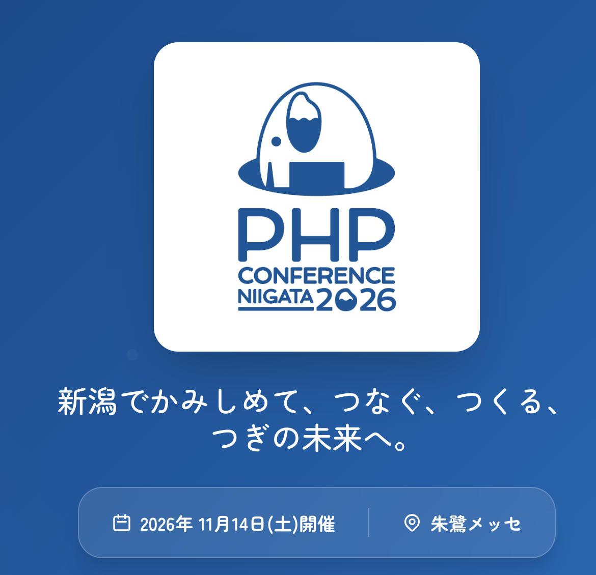

https://phpcon.niigata.jp/

---

# チケット

| 種別 | 内容 | 価格 |
|---|---|---|
| 一般 | 本編 ＋ お弁当 | 3,500円 |
| 一般（懇親会つき） | 本編 ＋ お弁当 ＋ 懇親会 | 8,000円 |
| 個人スポンサー | 本編 ＋ お弁当 ＋ 懇親会 ＋ 公式サイトにアイコン掲載 | 13,000円 |
| 個人スポンサー（本編参加なし） | 公式サイトにアイコン掲載 | 5,000円 |

※現地参加のチケットにはすべて新潟三新軒様のお弁当がつきます。
※私を含め、スタッフを通して買うと500円安くなります

<!--
懇親会つきの販売期限・当日券の扱いは未確定のため載せない（2026/10/29）。当日券にお弁当がつくかも未確認。
-->

---

<!-- _class: message -->

# 2. セッションの魅力Sessions

---

<!-- _class: persona -->

# こんな方に楽しんでほしくて選びました

| こんな方に | だから |
|---|---|
| **PHPがメインではない方** | 言語を問わず楽しめるトークが **17本**（25本中） |
| **カンファレンスやPHPがはじめての方** | 初心者向けのトークが **8本** |

両方にあてはまる7本は、次のスライドで

<!--
「全国のPHPer向け」だけでなく「PHP以外がメインの人」「まだ慣れていない人」が楽しめるように選んだ、が軸。
募集時も、PHP以外（DB・インフラ・CS・AI）の話や、新潟ゆかりの方・初登壇・初心者向けのトークを特に歓迎していた。
-->

---

<!-- _class: sessions compact -->

# PHPを書いていなくても楽しめる7本

| 時刻 | セッション | 登壇者 |
|---|---|---|
| 10:50 A | 疎結合とは何か？ソフトウェア設計における結合バランスについて考える設計｜結合を強さ・距離・変わりやすさの3軸で整理 | 梶川琢馬さん |
| 14:40 A | 生成AIを用いてチーム開発する際の７つのポイント　仮説検証のポイントを漫画『瑠璃の宝石』をヒントにしてAI・チーム開発｜観察・データ・多様なチームの7ポイント | 小泉岳人さん |
| 15:40 A | imagewebp()の向こう側―WebPはなぜ JPEG・PNGより軽いのかWeb・画像｜2つのコーデックを数式なしの図で解説 | ゆずねりさん |
| 16:25 LT | 手の動かし方がわからなかった私が個人開発者になるまで個人開発｜未経験からWebアプリ公開まで | ポチさん |
| 16:30 LT | 私のコードは、ぜんぶAIが書いていた 〜2年目、写経で取り戻す〜学び直し｜AIの出力を写経しながら、AIと壁打ち | 永瀬博之さん |
| 17:10 LT | The PHP Foundation ： 推しの組織は謎組織♥OSS｜言語を支える財団は何をしているのか | fkuMnkさん |
| 17:15 LT | “まず動く”と、なぜ世界が広がるのかコミュニティ｜1枚のTシャツから、新潟のコアスタッフへ | 河村直樹さん |

<strong>7本とも Track A</strong>：初心者向けかつ言語を問わずのトーク。Track A にいれば全部聴けます

<!--
公式noteのセッション紹介 第7弾（PHPを書いていない方向け）の5本に、第6弾で「PHPを書いていない方にもおすすめ」とした永瀬さん・fkuMnkさんのLTを足した7本。
fortee の「初心者向け」タグ × 「言語を問わずおすすめ」の両方がついたトークは、この7本で全部。
-->

---

# 当日の登壇者

<figure>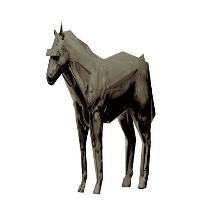<figcaption>梶川さん</figcaption></figure>
<figure>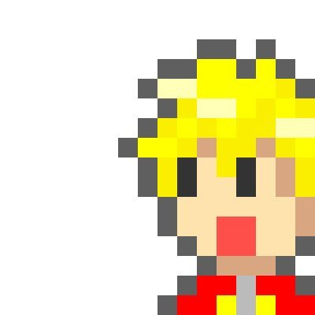<figcaption>meiheiさん</figcaption></figure>
<figure><figcaption>村田さん</figcaption></figure>
<figure><figcaption>あすと.さん</figcaption></figure>
<figure>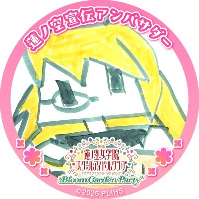<figcaption>tadsanさん</figcaption></figure>
<figure>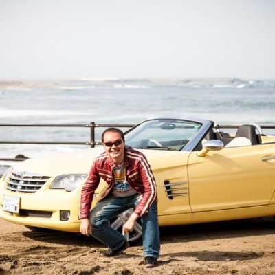<figcaption>sizuhikoさん</figcaption></figure>
<figure>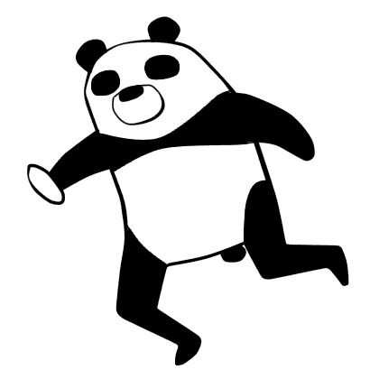<figcaption>河瀨さん</figcaption></figure>
<figure>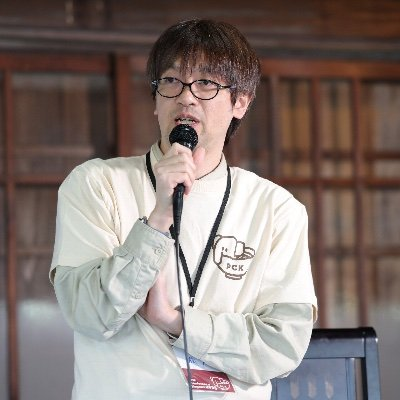<figcaption>松尾さん</figcaption></figure>
<figure><figcaption>小泉さん</figcaption></figure>
<figure>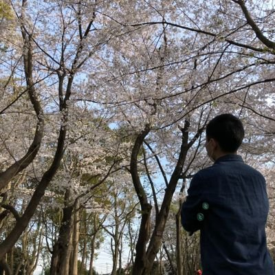<figcaption>ざきさん</figcaption></figure>
<figure><figcaption>wakabaさん</figcaption></figure>
<figure><figcaption>赤間さん</figcaption></figure>
<figure><figcaption>ゆずねりさん</figcaption></figure>
<figure>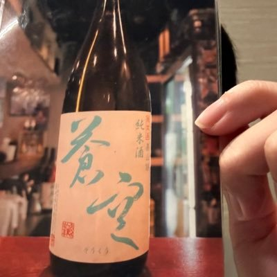<figcaption>つっつんさん</figcaption></figure>
<figure>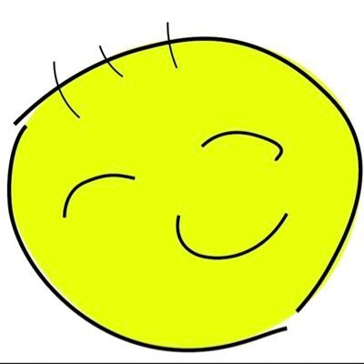<figcaption>あきさん</figcaption></figure>
<figure>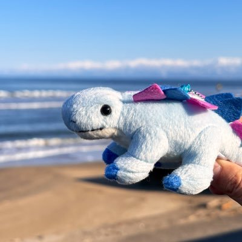<figcaption>ポチさん</figcaption></figure>
<figure><figcaption>永瀬さん</figcaption></figure>
<figure><figcaption>かはぴぴさん</figcaption></figure>
<figure>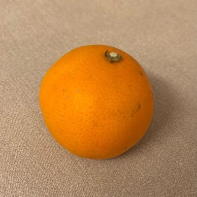<figcaption>ムナカタさん</figcaption></figure>
<figure>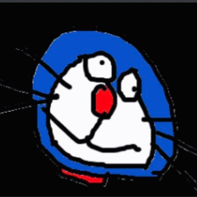<figcaption>マグロさん</figcaption></figure>
<figure><figcaption>福井さん</figcaption></figure>
<figure>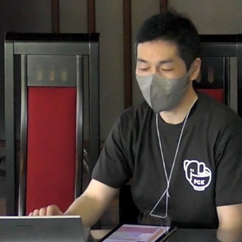<figcaption>fkuMnkさん</figcaption></figure>
<figure><figcaption>河村さん</figcaption></figure>
<figure><figcaption>あくしもさん</figcaption></figure>

<!--
アイコンは fortee（公式サイトと同じ画像）。赤間さんはアイコン未登録のため fortee の既定アイコン。
並びはタイムテーブル順。
-->

---

# セッションをテーマ別に見る

| テーマ | 本数 | 初心者向け | 言語を問わず |
|---|---|---|---|
| ① AI時代、エンジニアの仕事はどう変わる？ | 3 | 1 | 2 |
| ② より良いコードと開発現場をつくるには？設計する / 課題を見つけて改善する | 7 | 1 | 5 |
| ③ エンジニアとして、新しい一歩を踏み出してみませんか？自分の力を育てる / 新しい世界へ踏み出す | 6 | **3** | 5 |
| ④ PHPの奥深さを探るもう一段深く知る / 技術の可能性を探る | 6 | 2 | 2 |
| ⑤ コードの外に広がる、エンジニアの世界 | 3 | 1 | 3 |

ラベル：初心者向け初登壇新潟枠（fortee のタグ）言語を問わず PHP以外がメインの人にもおすすめ　Track欄の「LT」は5分のライトニングトーク

<!--
5テーマは公式のセッション紹介（公開予定）の章立て。
PHP歴が短い方は③から、PHP以外がメインの方は「言語を問わず」の多い②③⑤から見てもらう。
-->

---

<!-- _class: sessions -->

# ① AI時代、エンジニアの仕事はどう変わる？

| 時刻 | セッション / キーワード｜見どころ | 登壇者 |
|---|---|---|
| 14:40 A | 生成AIを用いてチーム開発する際の７つのポイント　仮説検証のポイントを漫画『瑠璃の宝石』をヒントにして初心者向け言語を問わずチーム開発・仮説検証｜観察・データ・多様なチームの7ポイントを漫画で整理 | 小泉岳人さん |
| 14:40 B | AI駆動で挑む！？レガシーPHPプロダクトのバージョンアップへの軌跡初登壇レガシー・PHP 8.4｜8万テーブルの生PHPを、7.3から8.4へ | ざきさん |
| 15:10 A | AIコーディングをセッションで終わらせない：PHPライブラリ開発におけるコンテキスト承継設計新潟枠言語を問わずコンテキスト承継｜「忘れるAI」でも引き継げる作業日誌と判断基準 | wakabaさん |

<strong>こんな人に聴いてほしい</strong>：古いPHPの改修や、AIのコードレビューに悩む人

---

<!-- _class: sessions -->

# ② より良いコードを設計する

| 時刻 | セッション / キーワード｜見どころ | 登壇者 |
|---|---|---|
| 10:50 A | 疎結合とは何か？ソフトウェア設計における結合バランスについて考える初心者向け言語を問わず結合度・設計｜結合を強さ・距離・変わりやすさの3軸で整理 | 梶川琢馬さん |
| 11:20 A | 新潟で型を"かみしめて"語ってみる 〜つぎの未来をつくる「型の本質」〜型の本質｜金額と個数を同じintで混ぜない。Value Object・Enum | 村田祐葵さん |
| 11:50 A | 何がPHPの静的解析を特別にしたのか言語を問わず静的解析｜Ruby・Pythonの静的解析を作ってきた登壇者が比べる | tadsanさん |
| 14:10 A | どうしても Eloquent でリポジトリパターンをやりたいんだLaravel・Eloquent｜大規模プロジェクトでの実践と「やる意味」 | 河瀨翔吾さん |

<strong>こんな人に聴いてほしい</strong>：Laravel・PHPの設計に悩む人

---

<!-- _class: sessions -->

# ② 開発・運用の課題を見つけて改善する

| 時刻 | セッション / キーワード｜見どころ | 登壇者 |
|---|---|---|
| 15:10 B | テストの副作用を発見・修正してPHPUnitを爆速にする言語を問わずPHPUnit・高速化｜10分超のテストを60秒に。犯人は二分探索で探す | 赤間仁志さん |
| 15:40 B | メール到達性を支える、リンク先URLのドメイン評価の扱い方言語を問わずメール到達性｜届かないメールの原因を追い、Spamhausを組み込む | つっつんさん |
| 16:40 LT | 落とし穴にハマってわかった開発生産性を測るときに気をつけたいこと言語を問わず開発生産性｜数字だけ良くなる「数値ハック」の実体験 | ムナカタさん |

<strong>こんな人に聴いてほしい</strong>：テストや開発生産性を改善したい人

---

<!-- _class: sessions -->

# ③ 日々の仕事と学びから、自分の力を育てる

| 時刻 | セッション / キーワード｜見どころ | 登壇者 |
|---|---|---|
| 10:50 B | エラーチャンネルのボールを拾い続けて鍛えるエンジニアの地力言語を問わず保守運用・地力｜エラー通知を拾い続けて育つオーナーシップ | meiheiさん |
| 16:25 LT | 手の動かし方がわからなかった私が個人開発者になるまで初心者向け初登壇言語を問わず個人開発｜未経験からQiita投稿、Webアプリ公開まで | ポチさん |
| 16:30 LT | 私のコードは、ぜんぶAIが書いていた 〜2年目、写経で取り戻す〜初心者向け言語を問わず学び直し・写経｜AIの出力を写経しながら、AIと壁打ちする | 永瀬博之さん |

<strong>こんな人に聴いてほしい</strong>：日々の仕事から成長したい人

---

<!-- _class: sessions -->

# ③ 興味を行動に変えて、新しい世界へ踏み出す

| 時刻 | セッション / キーワード｜見どころ | 登壇者 |
|---|---|---|
| 11:20 B | OSSコントリビュート未経験者がLaravelに新規メソッドを追加するまでの話初登壇OSS・Laravel｜whenEnum() のPRがマージされるまで | あすと.さん |
| 16:15 LT | 自分が欲しいソフトウェアを作るとき、あなたはドメインエキスパートだ言語を問わず小さなプロダクト｜楽器練習アプリに、奏者としての知識が活きた | あきさん |
| 17:15 LT | “まず動く”と、なぜ世界が広がるのか初心者向け言語を問わずコミュニティ｜1枚のTシャツから、新潟のコアスタッフへ | 河村直樹さん |

<strong>こんな人に聴いてほしい</strong>：OSSや個人開発に踏み出したい人

---

<!-- _class: sessions -->

# ④ 普段使っているPHPを、もう一段深く知る

| 時刻 | セッション / キーワード｜見どころ | 登壇者 |
|---|---|---|
| 14:10 B | PHPのバージョンアップ時にASTが変わらない変更の見抜き方AST・互換性｜php-astで比べて、テスト工数を大きく減らす | 松尾篤さん |
| 17:00 LT | HTTP通信に使おうとすると実はめんどくさいfile_get_contents初心者向け標準関数・HTTP｜普段はRubyを書く登壇者が見たPHPの落とし穴 | マグロさん |
| 17:05 LT | PHPのインクリメント機能の不思議演算子・str_increment()｜文字列の ++ と、str_increment() が生まれた背景 | 福井将之さん |

<strong>こんな人に聴いてほしい</strong>：PHPの仕様をもっと深く知りたい人

---

<!-- _class: sessions -->

# ④ PHPから広がる技術の可能性を探る

| 時刻 | セッション / キーワード｜見どころ | 登壇者 |
|---|---|---|
| 11:50 B | Wasm は PHP と JS の壁を壊せるか？ Extism プラグインシステムがもたらす越境開発言語を問わずWasm・Extism｜フロントとバックをまたぐ Extism のデモ | sizuhikoさん |
| 15:40 A | imagewebp()の向こう側―WebPはなぜ JPEG・PNGより軽いのか初心者向け言語を問わず画像フォーマット｜2つのコーデックを数式なしの図で解説 | ゆずねりさん |
| 16:20 LT | PHPで家庭用ゲーム機の専用コントローラーをMIDIデバイスとして扱ってみるPHP FFI・MIDI｜PHP FFIで鍵盤を読み、仮想MIDIデバイスへ | つっつんさん |

<strong>こんな人に聴いてほしい</strong>：PHPでいつもと違うことをしたい人

---

<!-- _class: sessions -->

# ⑤ コードの外に広がる、エンジニアの世界

| 時刻 | セッション / キーワード｜見どころ | 登壇者 |
|---|---|---|
| 16:35 LT | 斧を (物理的に) 研ぐということ言語を問わず道具・準備｜林業に携わる登壇者が、チェンソーを研ぐ | かはぴぴさん |
| 17:10 LT | The PHP Foundation ： 推しの組織は謎組織♥初心者向け言語を問わずPHP Foundation・OSS｜設立から約5年、財団は何をしているのか | fkuMnkさん |
| 17:20 LT | 新潟の364日を考えよう新潟枠言語を問わず地域コミュニティ｜東京から移住した運営者が語る、地方コミュニティのリアル | あくしもさん |

<strong>こんな人に聴いてほしい</strong>：コードの外から刺激がほしい人

---

<!-- _class: message -->

# タイプ別モデルルートModel routes

---

<!-- _class: types -->

# あなたはどのタイプ？

| タイプ | こんな方 | 選び方 → 1日で聴けるもの |
|---|---|---|
| **① はじめての方** | カンファレンスやPHPがはじめての方 | 初心者向け を軸に → 設計・OSS・AI・テスト・画像の基本を一通り |
| **② PHPを書いていない方** | メイン言語がPHP以外の方 | 言語を問わず を軸に → 運用・Wasm・AI・画像、コードの外の話まで |

どちらも朝の自己紹介から懇親会まで。気になる枠は、もう片方のトラックに移ってもOK

---

<!-- _class: sessions route -->

# ルート① はじめての方

カンファレンスやPHPがはじめての方へ。<strong>初心者向け</strong> のトークを軸に、設計・OSS・テストの基本を一通り

| 時刻 | 聴くもの・やること | ポイント |
|---|---|---|
| 10:00 | オープニング → **10:15 グループで自己紹介** | 最初の話し相手ができる |
| 10:50 A | 梶川琢馬さん：疎結合と結合バランス初心者向け言語を問わず | 設計を3つの軸で整理 |
| 11:20 B | あすと.さん：はじめてのLaravelコントリビュート初登壇 | 未経験からPRマージまで |
| 11:50 A | tadsanさん：PHPの静的解析言語を問わず | Ruby・Pythonと比べる |
| 12:10 | お昼（お弁当）・12:30 スポンサーのエレベーターピッチ／LT | 各社の技術が聞ける |
| 13:00 | アンカンファレンス・OST | その場でテーマを持ち寄る |
| 14:10 A | 河瀨翔吾さん：Eloquentでリポジトリパターン | 設計の「やる意味」 |
| 14:40 A | 小泉岳人さん：生成AIでチーム開発する7つのポイント初心者向け言語を問わず | 漫画で整理 |
| 15:10 B | 赤間仁志さん：PHPUnitを爆速に言語を問わず | 10分超を60秒に |
| 15:40 A | ゆずねりさん：WebPはなぜ軽いのか初心者向け言語を問わず | 数式なしの図で |
| 16:15〜 | LT：**ポチさん**初登壇（個人開発）・**永瀬さん**（写経で学び直し）・**河村さん**（まず動く） | 同じ目線の話 |
| 17:30 | エンディング → **懇親会** | 1日で知り合った人ともう一歩深く |

<!--
初心者向けタグを軸に選んだルート（research-memo.md の旧ルートA）。11:20 と 15:10 は初心者向けタグがないので、初心者が入りやすい方を選んだ。
-->

---

<!-- _class: sessions route -->

# ルート② PHPを書いていない方

<strong>言語を問わず</strong> 楽しめるトークを軸に、PHPを書かなくても持ち帰れるものを

| 時刻 | 聴くもの・やること | ポイント |
|---|---|---|
| 10:00 | オープニング → **10:15 グループで自己紹介** | 最初の話し相手ができる |
| 10:50 B | meiheiさん：エラーのボールを拾い続ける言語を問わず | 明日の仕事に持ち帰れる |
| 11:20 A | 村田祐葵さん：型の本質 | 金額と個数を混ぜない |
| 11:50 B | sizuhikoさん：WasmでPHPとJSの壁を壊す言語を問わず | フロントの人にも |
| 12:10 | お昼（お弁当）・12:30 スポンサーのエレベーターピッチ／LT | 各社の技術が聞ける |
| 13:00 | アンカンファレンス・OST | その場でテーマを持ち寄る |
| 14:10 B | 松尾篤さん：ASTでバージョンアップを見抜く | テスト工数を減らす |
| 14:40 A | 小泉岳人さん：生成AIでチーム開発する7つのポイント初心者向け言語を問わず | 漫画で整理 |
| 15:10 A | wakabaさん：AIコーディングのコンテキスト承継新潟枠言語を問わず | 作業日誌と判断基準 |
| 15:40 A | ゆずねりさん：WebPはなぜ軽いのか初心者向け言語を問わず | 数式なしの図で |
| 16:15〜 | LT：**かはぴぴさん**（斧を研ぐ）・**fkuMnkさん**（PHP Foundation）・**あくしもさん**新潟枠（新潟の364日） | コードの外の話も |
| 17:30 | エンディング → **懇親会** | 1日で知り合った人ともう一歩深く |

<!--
言語を問わずタグを軸に選んだルート（research-memo.md の旧ルートB）。11:20・14:10 は両トラックとも PHP寄りなので、言語に依存しにくい方を選んだ。Track A の7本だけで回る選び方もある（13枚目）。
-->

---

<!-- _class: message -->

# 3. セッション以外の カンファレンスの魅力Beyond the sessions

---

# 1人参加でも大丈夫！

* **朝 10:15〜**：3〜5人のグループで自己紹介
  * お題には「好きな日本酒」「行ってみたい新潟のスポット」も
* **昼 13:00〜14:00**：アンカンファレンス・OST
  * その場でテーマを持ち寄って、聴くも話すも自由
* **夜**：懇親会で、1日で知り合った人ともう一歩深く
* **途中参加もOK**：「午前だけ」「LTだけ」でも

<!--
お題と途中参加OKは KomeKaigi 参加者向け note と同じ内容。
OST は Open Space Technology（その場でテーマを出し合い、興味のある輪に自由に加わる）。旧版の「IRT」は誤りだったので OST に直した。
-->

---

# セッションの合間は、新潟の甘酒とコーヒーで

<figure><figcaption>今代司 の甘酒</figcaption></figure>
<figure>

<figcaption>ARARAT CREWS のコーヒー</figcaption></figure>

画像：今代司酒造 https://imayotsukasa.co.jp/　ロゴ：ARARAT CREWS

<!--
甘酒の写真は今代司酒造の商品ページ「麹・発酵甘酒 麹（ノン・アルコール）」より。
https://imayotsukasa.co.jp/product/kouji/132/
ARARAT CREWS のロゴは NEWSCAST のプレスリリース（会社概要）に掲載のもの。
https://newscast.jp/news/0963261 （公式サイト nsaveararat.com は 2026/10/21 時点で接続できず）
-->

---

# ランチは新潟三新軒様のお弁当

* 参加チケットに含まれています
* お昼は、スポンサー企業の **エレベーターピッチ・LT** も

<figure>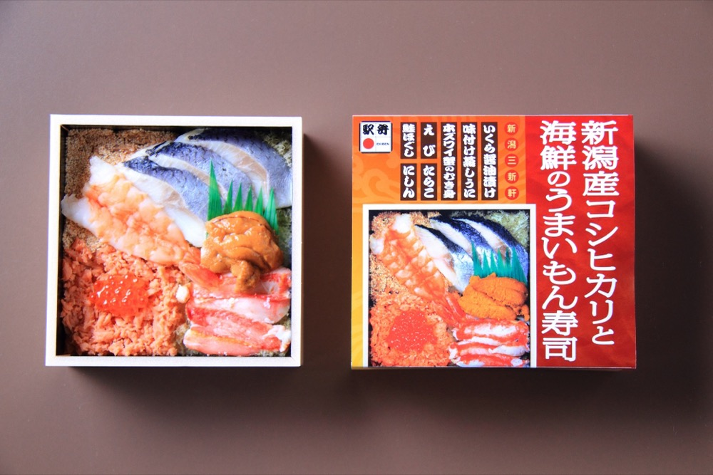<figcaption>新潟産コシヒカリと海鮮のうまいもん寿司</figcaption></figure>
<figure>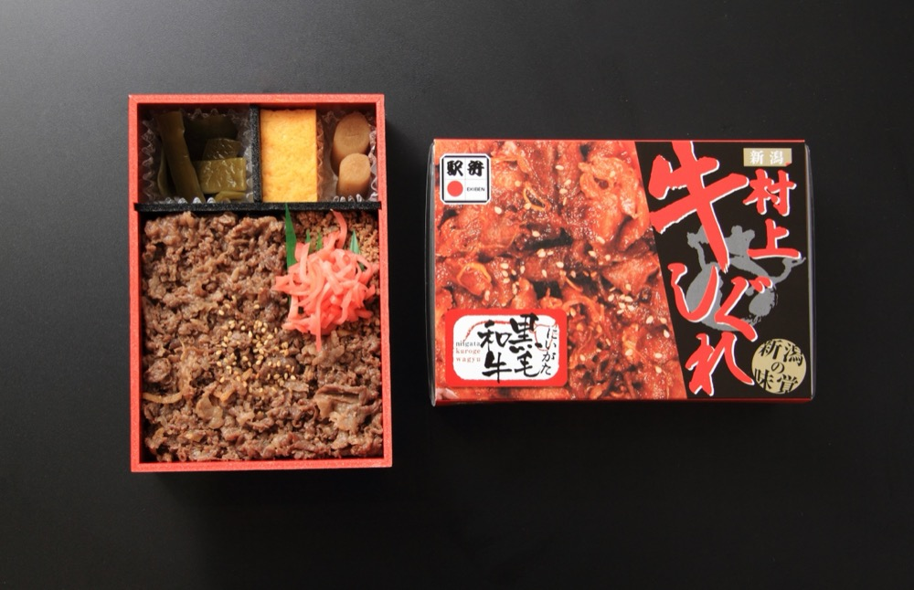<figcaption>村上牛しぐれ</figcaption></figure>

<!--
画像出典: 新潟三新軒 商品ページ（新潟産コシヒカリと海鮮のうまいもん寿司 / 村上牛しぐれ）
https://www.niigata-sanshinken.co.jp/products/2585/ , https://www.niigata-sanshinken.co.jp/products/794/
-->

画像：新潟三新軒 https://www.niigata-sanshinken.co.jp/

---
# 懇親会は新潟グルメで舌鼓を打ちましょう

* **懇親会のごはん**：昨年は利き酒コーナーや、新潟名物 **タレカツ** も
* 全国から来たエンジニアと、新潟の参加者が交わる場
* 朝や昼に **知り合った人** と、もう一歩深く話せる
* 自己紹介のお題「好きな日本酒」の答え合わせも

---

# 会場へのアクセス

* **朱鷺メッセ**（新潟市中央区万代島）
* 新潟駅から **路線バスで約10分**（17番のりば・大人260円）
* 歩いても **約20分**
* 地元だから、**懇親会まで気軽に** 参加できます

<!--
バスは公式note「おすすめホテル10選」の記載（新潟駅17番のりば、朱鷺メッセ方面）。
徒歩・バスの所要時間は公式サイトの記載。
-->

---

# まとめ

1. PHPは社会を支えている。**PHPコミュニティに入ってみませんか？**
2. 入口は **11/14(土) 朱鷺メッセ**。まずは **Track A の7本** から
3. 朝の自己紹介から夜の懇親会まで、**人とつながれる**

---

<!-- _class: message -->

# 11/14(土)は朱鷺メッセに行きましょう！

---
<!-- _class: promo -->

# チケットはこちら

* 一般 3,500円 / 懇親会つき 8,000円（お弁当つき）
* `PHPCON-NIIGATA-000XYZNI` を入力すると500円安くなります！

https://conference.findy-code.io/conferences/phpconniigata-2026/31/registration

<!--
QRを出したまま少し間を取る。読み取る時間をあげる。
購入後の返金は不可。学生向けは別途案内予定。
-->

---

<!-- _class: profile -->

# 自己紹介

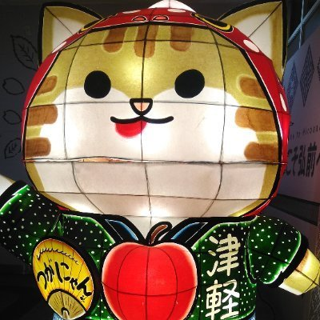

おさない

X: @000sak000

- PHPカンファレンス新潟2026 コアスタッフ

