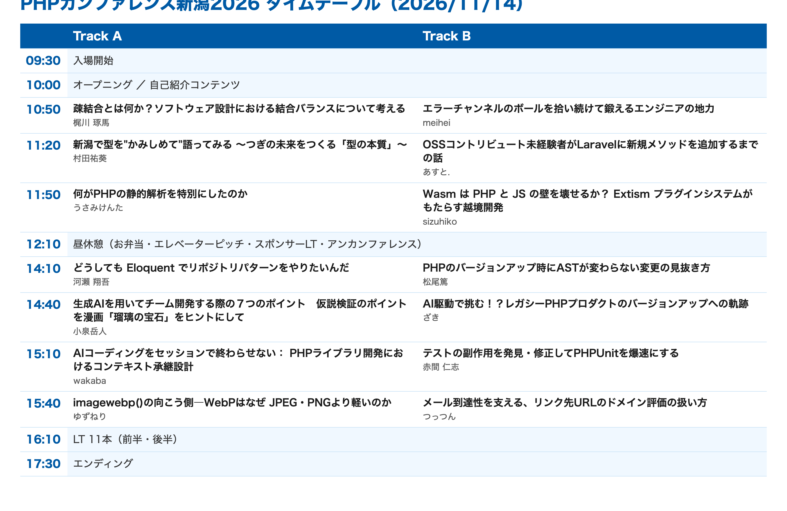
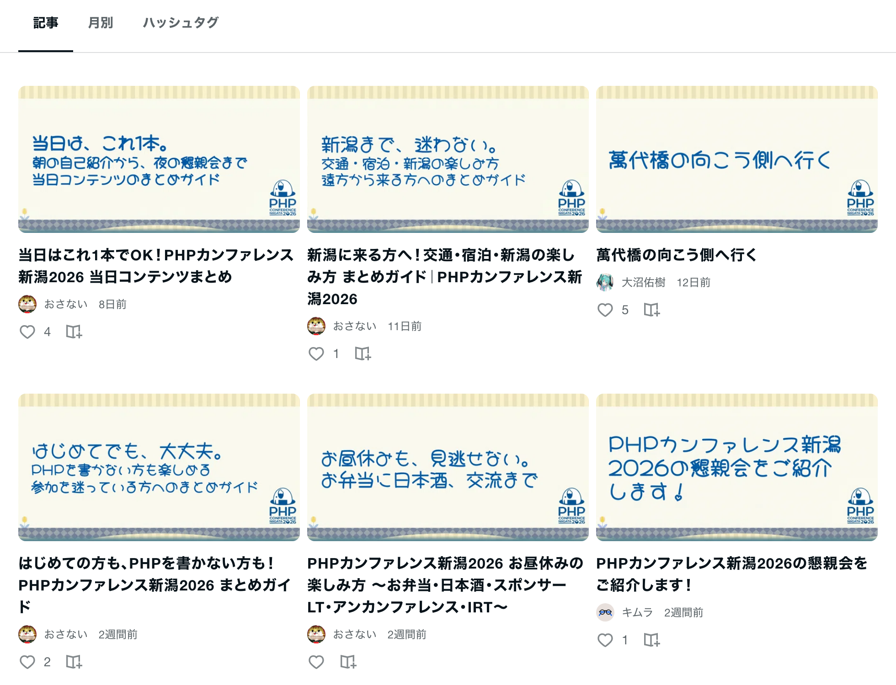
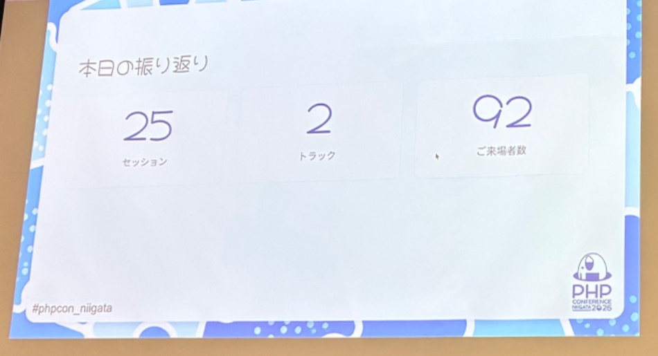
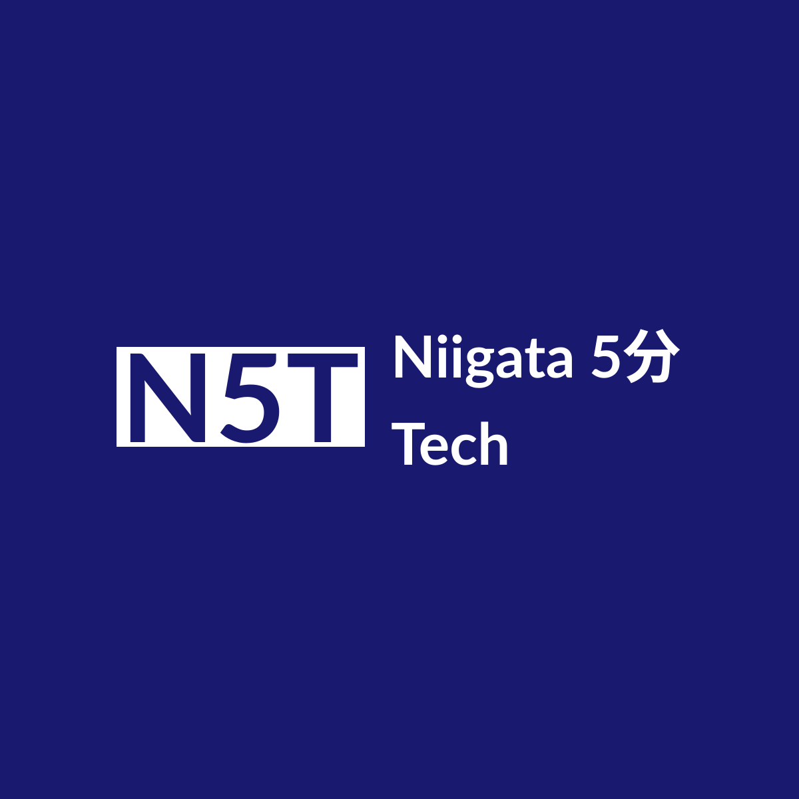
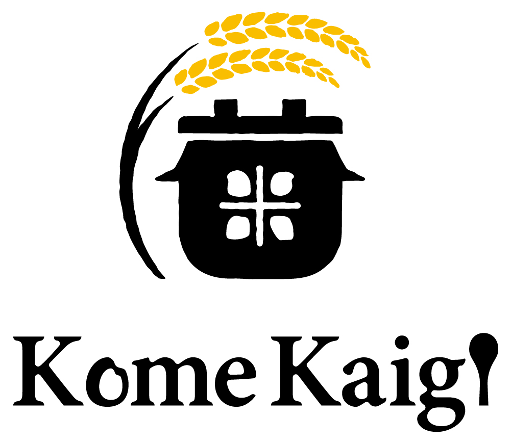
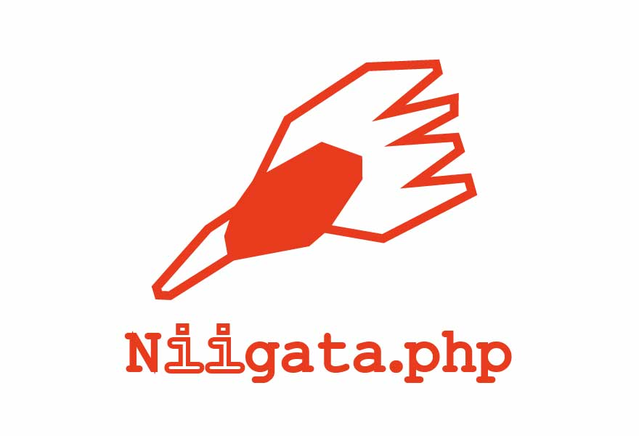
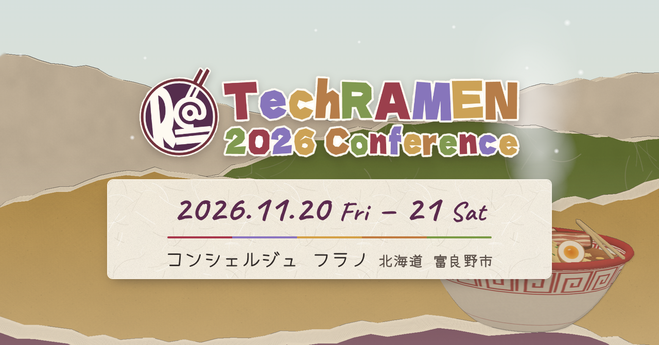
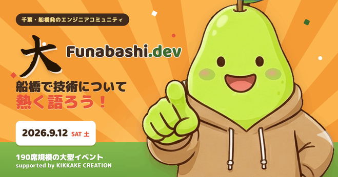
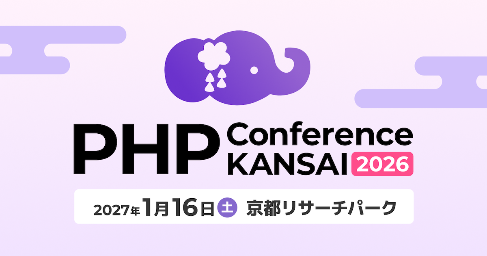
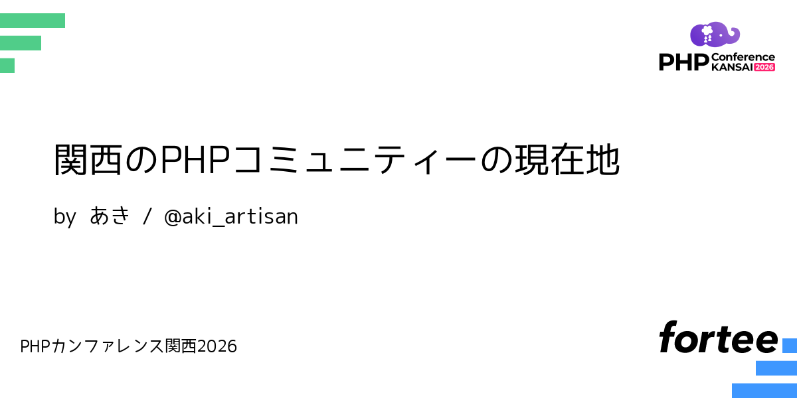

<!-- _class: title -->

# PHPカンファレンス新潟がこの先生きのこるには ―1コアスタッフの目線から―

2026/11/21 TechRAMEN 2026 Conference

おさない

<!--
〜0:10 タイトルを読む。「新潟2026でコアスタッフをやってた、おさないです」
-->

---

# おことわり

- 本LTは発表者個人の見解であり、実行委員会の公式見解ではありません
- 特定の人物や団体を批判する意図はありません

<!--
〜0:15 さらっと読む。
-->

---

<!-- _class: message -->

# PHPカンファレンス新潟2026に参加してくださった皆さん、ありがとうございました！

<!--
〜0:30 関わってくれた皆さんへの感謝。
-->

---

# 私のロール

* 準備期間の前半：プロポーザル・タイムテーブル周り
* 準備期間の後半：SNS・note の執筆とディレクションも兼任

  <figure><figcaption>タイムテーブル（fortee のデータから作成）</figcaption></figure>
  <figure><figcaption>note マガジン</figcaption></figure>

<!--
〜0:45 兼任になった理由（誰の代わりか）は言わない。
-->

---

# 開催した結果

* 参加者は92名
* 「来年もまた開催して」という声もいただいた
* 事前準備や当日の運営に課題

  <figure><figcaption>エンディングの「本日の振り返り」（@phpcon_niigata の投稿写真より）</figcaption></figure>

<!--
〜1:00 数字は淡々と。よかったことは素直に嬉しかったと言う。課題の具体例は挙げず、さらっと流す。
-->

---

<!-- _class: message -->

# 終わってから考えた、2つの問い

  

Q1

PHPカンファレンス新潟は、 来年以降も開催できる体制か？

  

Q2

新潟2026は、新潟の 普段のコミュニティと つながれていたか？

<!--
〜1:15 本題の問い。2つとも読む。間を取る。
-->

---

# Q1. 来年以降も開催できる体制か

* なんとか形にするので精一杯だった
* スタッフが抜けたとき「拾える人が拾う」構造になった
  * 私も役割の穴を放置し、当日は Track統括とSNS発信を兼任
* この状況では、来年以降も続けられるかどうか **判断できない**

<!--
〜2:00 答えは「まだ言えない」。人数・経験が足りなかったわけではない、と口頭で添える。偏りは自分の反省として話し、「私も含めて」を必ず入れる（特定の人＝委員長の話に聞こえないように）。抜けた人数・理由は言わない。「無謀」「規模が重すぎる」とは言わない（規模と偏りのどちらが原因かは断定しない）。
-->

---

# Q2. 新潟の普段のコミュニティとつながれていたか

* 新潟の方が、新しくスタッフとして関わってくださった
* 開催2週間前に、新潟の技術イベント「Niigata 5min Tech」「Komekaigi」に参加
  * Komekaigi 経由で、参加者・当日スタッフの方につながった

  <figure><figcaption>Niigata5分Tech #28（10/30）</figcaption></figure>
  <figure><figcaption>KomeKaigi 2026（10/31）</figcaption></figure>

<!--
〜2:20 「2つ目の答えは、半分かなと」から入る。希望の話として。「来てくれた人がいたのは本当に嬉しかった」
-->

---

# Q2. 新潟の普段のコミュニティとつながれていたか

* 準備期間中に新潟の勉強会へ顔を出せたのは、KomeKaigiのほかに1回
* 運営は、私も含めてほぼ県外在住
* 新潟のコミュニティの方を対象とするなら、尚更重要

<!--
〜2:40 「私が顔を出せたのは1回だけ → 運営は私も含めてほぼ県外在住 → 新潟のコミュニティの方に来てほしいなら、普段からのつながりはなおさら大事」の流れで話す。3行目は Q2 の答えの「残り半分」として言い、13枚目（Q2への答え）で「勉強会なら普段から関われる」につなぐ。「出身」ではなく「在住」。新潟在住スタッフの人数は言わず「ほぼ県外」とだけ言う。「県外の人が運営していたのが悪い」には聞こえないよう、主語に「私も含めて」を入れる。特定の人の話にはしない（勉強会の主催者は委員長本人）。
-->

---

<!-- _class: message -->

# PHP勉強会in新潟が続く体制をつくることが、 PHPカンファレンス新潟が生きのこる道になる

<!--
〜2:50 今日いちばん言いたいことを先に言う1枚。「なので、今日いちばん言いたいのはこれです」と前置きして、ゆっくり読んで間を取る。「私がやる」「rebootする」とは言わない（主催者は委員長本人）。なぜそう言えるかは、11枚目で PHP勉強会in新潟を紹介したあと、12〜13枚目で Q1・Q2 に答える形で話す。締めは16枚目。
-->

---

# PHP勉強会in新潟とは

* 新潟でPHPについて話す勉強会（connpass: niigata.php）
* 2024年から2025年にかけて5回開催。
* 今はお休み中

  <figure><figcaption>PHP勉強会in新潟（connpass: niigata.php）</figcaption></figure>

<!--
〜3:00 県外の聴衆向けに、どんな場かを一言で。主催者が委員長であることは言わない。止まった理由・時期の解釈も言わない（言えるのは connpass の記録まで）。
-->

---

# Q1への答え：勉強会なら、小さく始めて任せられる

* 勉強会なら金銭的リスクも手間も小さく、スモールスタートできる
* 受付・告知など、運営を小さく切って任せられる
* 勉強会に携わってくださった人が、次のカンファレンスの担い手になるかも

<!--
〜3:15 最後の1行が、16枚目（締め）「勉強会の体制 → カンファレンスが生きのこる」への橋渡し。「任せられる」は Q1 の「負担が動ける人に偏った」への答え。
-->

---

# Q2への答え：勉強会なら、普段から関われる

* 課題：県外の私たちが新潟と関われたのは、カンファレンスの直前だけ
* 定期的な開催の場があれば、カンファレンスがない日もつながりを保てる

<!--
〜3:35 「直前だけ」→「普段から」の対比を意識して話す。
-->

---

# ケの日の延長に、ハレの日がある

  <figure><figcaption>ゆるい勉強会@旭川・FuraIT@富良野 → TechRAMEN</figcaption></figure>
  <figure><figcaption>多摩.dev → TechTAMA 2026（多摩.dev #6）</figcaption></figure>
  <figure><figcaption>Funabashi.dev → 大Funabashi.dev</figcaption></figure>

新潟のPHPにも、ケの日の場をもう一度

<!--
〜3:50 左から TechRAMEN（運営メンバーの多くが旭川・富良野の勉強会から）、TechTAMA 2026（多摩.dev #6）、大Funabashi.dev（Funabashi.dev の拡大版）。口頭では TechRAMEN だけ「今日のこの TechRAMEN も、運営メンバーの多くが旭川・富良野の勉強会から来ています」と会場に向けて言う。TechTAMA・大Funabashi.dev はキャプションに任せて読まない。下の1行は次の「私の次の一歩」への橋渡し。特定の人の話にはしない（勉強会の主催者は委員長本人）。「新潟には勉強会がない」とは言わない（Niigata 5min Tech・Komekaigi がある）。
-->

---

# 私の次の一歩

* PHP勉強会in新潟はできれば再開したいと話している
* 県外の私にできるのは、そこに関わり続けること
  * 勉強会で登壇する、運営を手伝う、担い手を探す
* 勉強会が続く体制になるよう、その一端を担いたい

<!--
〜4:22 「私がやります」とは言わない。頻度も言わない。出典はツナギメエフエム第188回の文字起こし（要約で伝え、一字一句の引用はしない）。
-->

---

<!-- _class: message -->

# 次は、PHP勉強会in新潟の再開から始まる

<!--
〜4:45 一番伝えたい1枚。タイトルの「生きのこる」を回収する。ゆっくり読んで、間を取る。ありがとうございました。
-->

---

<!-- _class: promo -->

# PHPカンファレンス関西2026

* 日時：2027/1/16(土)
* 会場：京都リサーチパーク 4号館（JR丹波口駅から徒歩5分）

https://2026.kphpug.jp/

<!--
ここから宣伝3枚は、時間があるときだけ（4:45 を過ぎていたら飛ばして自己紹介へ）。名前は「2026」だが開催は2027年1月。
-->

---

# このLTの続きは、関西で

  

関西PHP勉強会の主催・PHPカンファレンス関西2025実行委員長のあきさんによるLT 勉強会とカンファレンスの「循環」の話

---

# チケット販売中・当日スタッフ募集中

  <figure>
    
チケット販売ページ

    
  </figure>
  <figure>
    
当日スタッフ募集中

    
  </figure>

<!--
「当日スタッフは運営が初めての方も大歓迎です。ケの日・ハレの日に関わる最初の一歩にぜひ」。
-->

---

<!-- _class: profile -->

# 自己紹介

おさない

X: @000sak000

- PHPカンファレンス新潟2026 コアスタッフ

<!--
〜4:50 「X は @000sak000 です。このあと、ぜひ話しかけてください」の一言だけ。
-->