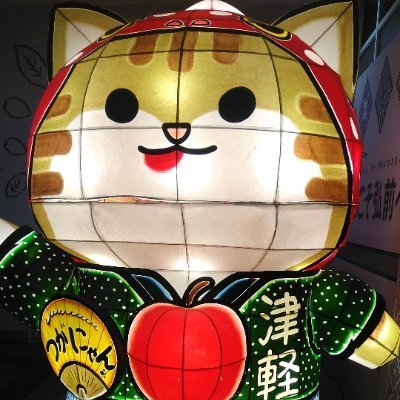

<!-- _class: title -->

# PHPカンファレンス新潟がこの先生きのこるには ー1コアスタッフの目線からー

2026/11/21 TechRAMEN 2026 Conference

おさない（PHPカンファレンス新潟2026 コアスタッフ）

※本LTは発表者個人の見解であり、実行委員会の公式見解ではありません

<!--
0:00〜0:05 タイトルを読む。
-->

---

<!-- _class: profile -->

# 自己紹介

おさない

X: @000sak000

- PHPカンファレンス新潟2026 コアスタッフ（登壇者担当・当日セッション統括）
- 関西・香川などのPHPカンファレンスでもスタッフ

<!--
〜0:15 個人の見解であることを伝える。「当日セッション統括」は7枚目の伏線。
-->

---

<!-- _class: message -->

# ありがとうございました

11/14 PHPカンファレンス新潟2026 に 関わってくださった皆さん

<!--
〜0:25 短く。
-->

---

# 序盤は、売れなかった

- それでも、チケットは **約100人** まで回復
- PHPを書いていない人も楽しめるプログラム
- 「来年も行きたい」という声

<!--
〜0:50 「正直、胃が痛かった」は実感を込めて。販売状況を話すことは委員長の了承を取っておく。
-->

---

# 反省① 誰に届けたいのか

- 全国のPHPer？ 新潟の技術者？ が曖昧だった
- 運営はほぼ県外、地元への声かけは直前だけ

<!--
〜1:15 主語は「私も含めて」「私たち」。勉強会が止まっていた期間は、確認できたら追記する。
-->

---

# 反省② フルパッケージ・100人規模は必要か

- フルパッケージ ＝ 大きな会場・お弁当・懇親会・スポンサー
- お金と人のリスクを、**毎年** 背負えるか？
- 香川（私の経験）：会場費を抑えられているのが大きい

<!--
〜1:45 「求められていない」とは言わない。「来年も行きたい」という声がある前提で話す。
-->

---

# 反省③ スタッフ体制

- 抜けても引き継げる仕組みがなかった
- 動ける人が巻き取る → **その1人が自分**（兼務で部屋の運営が手薄に）

<!--
〜2:25 関西の比較は台本で話すだけ。最後の「正直思っちゃったんです」でスライドを送る。
-->

---

<!-- _class: message -->

# この体制で、 もう一度できるかな

<!--
〜2:30 自分への問いとして読む。読んだら間を取る。
-->

---

<!-- _class: message -->

# 提案

体制が整うまでは、カンファレンスより PHP勉強会in新潟の reboot を優先しませんか

委員長も、勉強会はできれば復活させたいと話していた（ツナギメエフエム 第188回）

<!--
〜2:55 委員長に事前共有できていなければ「委員長には事前に話してあります」は言わない。
-->

---

# 理由1 新潟には「普段の場」が要る

- KomeKaigi（年1回・言語を問わない）はもうある
- 普段から顔を合わせる小さい場がほしい
- まずは新潟の技術者に、一人で回せる規模から

<!--
〜3:20 KomeKaigiの参加者数は、確認できた数字だけ口にする。
-->

---

<!-- _class: message -->

# 理由2

カンファレンスは、 勉強会の延長線上に

顔を合わせる → 登壇・手伝いたい人が出てくる →「またやりたい」が出たら次へ

<!--
〜3:45 一番伝えたいスライド。間を取ってゆっくり話す。
-->

---

<!-- _class: message -->

# 続けられるか？ 3つの問い

Q1. 誰に届けたい？ Q2. お金と人のリスク、毎年背負える？ Q3. 誰かが抜けても回る？

<!--
〜4:05 新潟以外の聴衆への持ち帰り。写真を撮ってもらう1枚。
-->

---

<!-- _class: message -->

# まずは勉強会から

次のPHPカンファレンス新潟は、 普段の勉強会の延長に開きたい

同じことで悩んでる地域の方、このあと はじめましてさせてください

<!--
〜4:45 自分の一歩 → 締め → TechRAMENのテーマにかけた呼びかけ。
-->

---

<!-- _class: refs -->

# References

- PHPカンファレンス新潟2026 公式サイト https://phpcon.niigata.jp/
- 大沼佑樹「PHPカンファレンス新潟2026に向けて」 https://note.com/nicozetsche/n/n6905b340522a
- ツナギメエフエム 第188回 https://tsunagi.me/ep188/
- KomeKaigi 2026 https://komekaigi.dev/
- TechRAMEN 2026 Conference https://techramenconf.net/2026/

<!--
表示のみ。読み上げない。
-->
